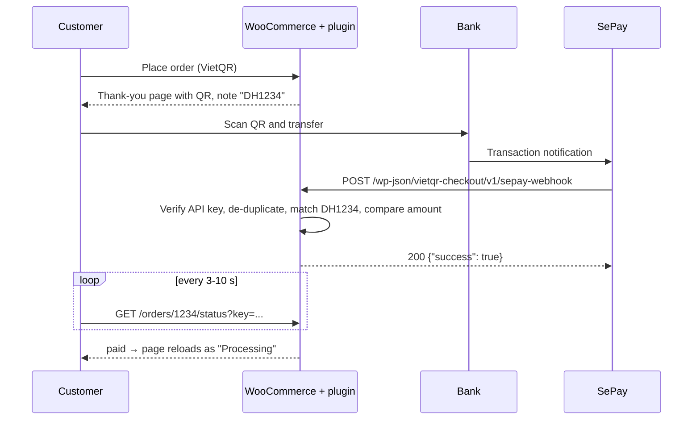

# VietQR Checkout for WooCommerce

[](https://github.com/PhjnX/vietqr-checkout/actions/workflows/ci.yml)


A WooCommerce payment gateway for Vietnamese bank transfers. The customer scans a VietQR code with any banking app, and the order is confirmed automatically a few seconds after the money arrives, through a [SePay](https://sepay.vn) webhook.

**[▶ Try the live demo in WordPress Playground](https://playground.wordpress.net/?blueprint-url=https://raw.githubusercontent.com/PhjnX/vietqr-checkout/main/blueprint.json)** — a full WooCommerce shop runs in your browser, no install. Add a product to the cart, check out with "Chuyển khoản VietQR", then press **Simulate payment** on the order page.

<!-- Add a 15-20 s GIF here: checkout → QR → simulate → order paid. -->

## The problem

Most small shops in Vietnam are paid by bank transfer. Without automation, someone has to watch the banking app, match each transfer to an order by hand and update the status. Customers mistype the amount or the note, and orders wait for hours.

## What the plugin does

- Shows a VietQR code with bank, account, amount and transfer note pre-filled, plus copy buttons for people paying on the same phone.
- Gives every order a payment code (`DH1234`) and finds it in the transfer note even when the bank rewrites it (`MBVCB.3561.DH1234.CT tu ...`, `dh 1234`).
- Receives SePay webhooks, verifies the API key, and marks the order as paid. The thank-you page updates on its own.
- Handles real-life cases: duplicate webhooks, partial payments, overpayments, money arriving after the order was cancelled.
- Cancels unpaid orders after a configurable time and returns their stock (Action Scheduler).
- Works with both the classic checkout and the Checkout block. Declares HPOS compatibility.
- Adds the transfer details to the "order on hold" email. Ships with a Vietnamese translation.
- Test mode with a **Simulate payment** button that runs the exact same code path as a real webhook.

## How it works



## Installation

1. Download `vietqr-checkout.zip` from the [latest release](https://github.com/PhjnX/vietqr-checkout/releases) and upload it in **Plugins → Add New → Upload**.
2. Set the store currency to **VND** (the gateway hides itself for other currencies).
3. Go to **WooCommerce → Settings → Payments → VietQR bank transfer** and fill in bank, account number, account holder and payment code prefix.
4. In [my.sepay.vn](https://my.sepay.vn) → **WebHooks**, add a webhook:
   - URL: the address shown on the settings page, `https://your-shop.vn/wp-json/vietqr-checkout/v1/sepay-webhook`
   - Authentication: **API Key**, content type **JSON**
   - Use the same API key in the plugin settings.
   - Set the payment code structure in SePay to the same prefix (`DH`).

> Some Apache hosts strip the `Authorization` header. If every webhook returns 401, add `SetEnvIf Authorization "(.*)" HTTP_AUTHORIZATION=$1` to `.htaccess`.

## Development

Requirements: Docker (for wp-env), Node.js, PHP 7.4+ and Composer.

```bash
git clone https://github.com/PhjnX/vietqr-checkout.git
cd vietqr-checkout
composer install

npx @wordpress/env start     # WordPress + WooCommerce + this plugin at http://localhost:8888 (admin / password)
composer check               # PHPCS (WordPress Coding Standards) + PHPStan level 6 + PHPUnit
```

`wp-env` runs `bin/demo-setup.php` after start: VND currency, demo products, gateway in test mode.

Test a webhook against the local site:

```bash
curl -X POST "http://localhost:8888/wp-json/vietqr-checkout/v1/sepay-webhook" \
  -H "Authorization: Apikey demo-api-key" \
  -H "Content-Type: application/json" \
  -d '{"id":1001,"gateway":"MBBank","transactionDate":"2026-10-19 21:00:00","accountNumber":"0123456789","code":null,"content":"MBVCB.123.DH15.chuyen tien","transferType":"in","transferAmount":159000,"accumulated":0,"referenceCode":"FT1001"}'
```

To receive real SePay webhooks on your machine, expose it with `cloudflared tunnel --url http://localhost:8888` and use the printed URL in SePay.

### Project structure

```
vietqr-checkout.php        Plugin header, autoloader, HPOS/blocks compatibility, bootstrap
src/
  Plugin.php               Wires the parts together
  Gateway.php              WC_Payment_Gateway: settings, process_payment()
  PaymentProcessor.php     Core rule: transaction → order (shared by webhook and simulator)
  RestController.php       REST routes: webhook, status polling, simulator
  TransactionLog.php       Custom table, INSERT IGNORE for idempotency
  Install.php              Table creation with dbDelta()
  Expiry.php               Cancels unpaid orders with Action Scheduler
  Frontend.php             Payment box, email instructions
  BlocksSupport.php        Checkout block integration
  Admin.php                Settings link, transactions panel on the order screen
  Payment/                 Pure PHP, unit-tested: PaymentCode, QrUrl, AmountCheck, Banks
  Webhook/                 Pure PHP, unit-tested: SepayTransaction, ApiKeyAuth
templates/payment-box.php  Markup of the QR box
assets/                    payment.js (polling, copy, countdown), blocks.js, CSS
tests/Unit/                PHPUnit tests
bin/demo-setup.php         Demo data for Playground and wp-env (not shipped)
```

### Design decisions

- **Idempotent webhook.** SePay retries on failure and admins can replay webhooks. The transaction ID is stored in a column with a `UNIQUE` key and inserted with `INSERT IGNORE`, so the database decides atomically whether a transaction is new. A `SELECT` before `INSERT` would race when two retries arrive together.
- **Answer 200 for transactions we cannot match.** A transfer without a code is not an error for SePay; returning 4xx would make it retry forever. Only a database failure returns 500.
- **Polling with the order key.** The status endpoint is public but requires the order key from the thank-you URL, compared with `hash_equals()`. Guests can poll without logging in, nobody can enumerate orders, and the response is sent with `Cache-Control: no-store`.
- **Business rules in pure PHP classes.** Code parsing, URL building, payload validation and amount comparison have no WordPress dependency and are covered by fast unit tests.
- **No build step, no runtime dependencies.** A small PSR-4 autoloader and plain JavaScript keep the plugin installable straight from git, which is what WordPress Playground does.

### Hooks

| Hook | Type | Use |
|---|---|---|
| `vqrc_transaction_processed` | action | `( string $result, SepayTransaction $tx, ?int $order_id )` — e.g. notify the shop on Telegram |
| `vqrc_banks` | filter | Add or rename banks in the settings dropdown (BIN => name) |

## Roadmap

- [ ] SePay HMAC signature verification as an alternative to the API key
- [ ] Casso webhook provider
- [ ] Admin page listing unmatched transactions with a "link to order" action
- [ ] Integration tests with the WordPress test suite

## License

GPL-2.0-or-later. Not affiliated with NAPAS, VietQR or SePay.


